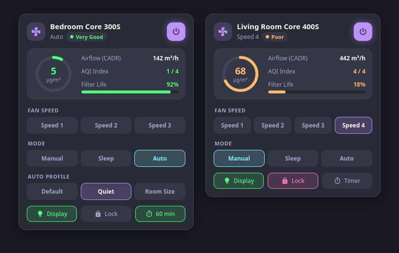

# Levoit ESPHome Card

[](https://github.com/hacs/integration)
[](LICENSE)

A clean, zero-dependency Home Assistant Lovelace card built for **Levoit air purifiers running [tuct/levoit](https://github.com/tuct/levoit) ESPHome firmware** — featuring a **Dracula** dark theme (plus adaptive Home Assistant theme mode), visual UI editor, and automatic entity discovery.



## Features

- **Zero-config entity auto-discovery** — pick your purifier's `fan.*` entity and the card automatically wires up PM2.5, AQI, CADR, Filter %, Filter Low, Operating Mode, Auto Profile, Display, Child Lock, Timer, and Error sensors.
- **Dracula theme built in** (`theme: dracula` default) — or switch to `theme: auto` to inherit your Home Assistant light/dark theme.
- **Adapts to your model** — automatically renders 3-speed (Core 200S / 300S) or 4-speed (Core 400S / 600S / Vital 200S) controls, hides missing sensors cleanly (e.g. Core 200S without PM2.5), and shows the Auto Profile selector only when Auto mode is active.
- **Visual card editor** — configure everything from the Home Assistant UI without touching YAML.
- **Single-file ES module** — zero external dependencies, instant loading.

## Supported Purifiers

Works out of the box with all ESPHome models supported by [`tuct/levoit`](https://github.com/tuct/levoit):
- Levoit Core 200S / 300S / 400S / 600S
- Levoit Vital 100S / 200S (Pro)
- Levoit Everest Air

*(Also works with other air purifier integrations if you specify entity overrides.)*

## Installation

### Via HACS (Recommended)

1. Open **HACS** in Home Assistant → **Frontend** → menu (`⋮`) → **Custom repositories**.
2. Add `https://github.com/wakuwakumiwaku/levoit-esphome-card` with category **Dashboard** (Lovelace).
3. Search for **Levoit ESPHome Card** and click **Download**.
4. Reload your browser.

### Manual

1. Download `levoit-esphome-card.js` from the [latest release](https://github.com/wakuwakumiwaku/levoit-esphome-card/releases).
2. Copy it to `<config>/www/levoit-esphome-card.js`.
3. Add `/local/levoit-esphome-card.js` as a **JavaScript Module** under **Settings → Dashboards → Resources**.

## Usage

Add the card from the Dashboard UI (**Add Card → Levoit ESPHome Card**) or use minimal YAML:

```yaml
type: custom:levoit-esphome-card
entity: fan.core300spaup_fan
```

### Options

| Option | Type | Default | Description |
|--------|------|---------|-------------|
| `entity` | string | **required** | Purifier `fan.*` entity ID |
| `name` | string | auto | Custom card title |
| `theme` | `dracula` \| `auto` | `dracula` | Dracula dark palette or inherit Home Assistant theme |
| `show_cadr` | boolean | `true` | Show current airflow (m³/h) |
| `show_filter` | boolean | `true` | Show filter life progress bar |
| `show_timer` | boolean | `true` | Show timer quick-cycle chip |
| `compact` | boolean | `false` | Tighter padding, hides section labels |

#### Optional Entity Overrides
If your entity names don't follow the default `tuct/levoit` prefix, you can override any entity individually:
`pm25_entity`, `aqi_entity`, `cadr_entity`, `filter_entity`, `filter_low_entity`, `display_entity`, `child_lock_entity`, `operating_mode_entity`, `auto_mode_entity`, `timer_entity`, `timer_remaining_entity`, `error_entity`.

## Local Preview

Open `demo.html` via any local HTTP server to preview and click through interactive mock purifiers:

```bash
python3 -m http.server 8000
# open http://localhost:8000/demo.html
```

## License

MIT
